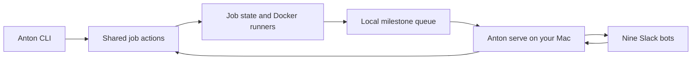

# Phase 6 implementation plan for the Slack dev team

**Goal.** Run Son of Anton jobs from Slack with the same two checkpoints and job records as the CLI. Nine Slack apps give the team individual bot identities. The PM takes work and asks spec questions, the delivery team posts and answers questions in job threads, and the coach brings lesson proposals to the owner.

**Base.** Phase 5b, tag `v0.8.0`. The [approved design](../../specs/2026-11-19-son-of-anton-design.md) §11 defines the roles, channels and owner rules. Use the existing subagent-driven workflow with per-task implementation and review and a final integration review for each slice.

**Architecture.** Slack runs as an optional macOS user service, `anton serve`, using Bolt for JavaScript in Socket Mode. Each app has its own socket and bot identity. Only the PM registers `/anton`. The CLI and Slack call shared job actions and read the same persisted state. A local Slack store holds only transport state, rendezvous records for questions and actions, and chat spend. Slack replies and job execution have independent lifecycles.

## Decisions and review focus

- **Two delivery slices, two existing job checkpoints.** 6a brings up the nine bots and durable updates for CLI-started jobs, with a live test in a dedicated Slack test workspace. 6b adds job control and Q&A and runs the complete cross-front-end smoke test. These are implementation milestones. Spec approval and final review remain the only job approval checkpoints.
- **Matching surfaces.** Slack and CLI share job actions for new, change, status, spec and delivery decisions, recovery, accepted risks and lesson decisions. Slack can also adopt a repo by its absolute path on the Mac, subject to the same CLI checks. Setup, secrets editing, local log following, and machine operations use the CLI. Show bounded log excerpts in Slack through Q&A.
- **Audience.** Use private, workspace-local `#anton` and `#proj-<slug>` channels by default. Members can see and ask about their project. Mutations require the configured workspace and owner IDs. Resolve by channel and thread IDs, never by display name. A project question outside its project channel gets an access-checked DM or a pointer to that channel. Shared channels, ambiguous project references and unverified membership get no project data.
- **Persistence.** Write Slack state under `~/anton/slack/` with atomic writes and safe reads. Never expose Slack credentials to Docker, job artifacts, models or raw SDK logs. Slack exports are generated from allowlisted fields. Attach the sanitized generated spec and explicitly eligible, validated QA screenshots. Keep arbitrary source files and raw logs local. Limit sizes, avoid link unfurls and strip mentions from untrusted content.
- **Concurrency.** Review CLI vs Slack approval, Slack retries, old buttons after rejection, and a new job replacing the old current job. Test these across processes at the persisted action boundary. Review reply replay after a crash, disconnect after a successful Slack send, and a restart with an unanswered spec prompt.
- **Cost.** Status and other structured lookups use zero model calls. Reserve paid chat cost before dispatch and enforce a separate $5 monthly default plus a small per-answer cap. No changes to build budgets, learner policy or agent model selection.
- **Failure boundaries.** Verify a denied or forged Slack request never calls an action or spends money. Simulate a changed membership, a bad role token, a symlinked artifact, sensitive model output, rate limits and an outage. Opt-in live verification uses a test workspace and a fake runner first. Paid verification is a separate opt-in.

## Phase 6a — set up the team and post job updates

### Task 1 — Resumable workspace setup and credentials

**Files.** Create `src/slack/config.ts`, `src/slack/setup.ts`, `src/slack/manifests.ts`, `src/cli/commands/slack.ts`, and `tests/slack/setup.test.ts`. Wire the CLI in `src/cli/index.ts`. Add the lockfile-pinned Slack SDK dependency. Centralize the role map against the nine roles in §11.1 so auxiliary factory agents do not create extra apps.

**Interface.** `slackSetup(deps): Promise<number>` provisions or resumes setup. `loadSlackConfig(home): Promise<SlackConfig | undefined>` validates nonsecret workspace, owner, channel and per-role app/bot IDs separately from credentials. Store desktop runtime credentials in an owner-readable-only file (0600 in a 0700 directory) using protected input and atomic replacement. The configuration access token is transient. Record provisioned app IDs as they are created. A timeout of unknown outcome goes to reconciliation by app ID before another create is allowed.

- [ ] Write failing tests for all nine roles, PM-only command scope, wrong workspace, partial setup and rerun, inaccessible files and masked output. Run `npx vitest run tests/slack/setup.test.ts` and confirm failures.
- [ ] Build manifests with Socket Mode, bot identity, mention and DM events. Give channel management and private thread reply events to the PM. Give the PM and QA file-upload permissions for their artifacts. Give the outbox bounded read access for reconciliation only where the owning bot needs it. Setup creates apps with the manifest API, guides the operator through install and per-app token creation, and validates the token identities before saving roles. Create or explicitly bind `#anton`. Invite the owner and bots where Slack permits it, and guide the owner through any invitation the workspace restricts. Reruns reuse validated IDs. Never adopt an existing channel by name alone.
- [ ] Run the setup tests and type check. Commit `feat(slack): provision workspace bots and credentials`.

### Task 2 — Event capture and a persistent delivery queue

**Files.** Create `src/slack/events.ts`, `src/slack/outbox.ts`, `src/slack/artifacts.ts`, and `tests/slack/outbox.test.ts`. Add optional event dependencies in `src/pipeline/runner.ts`, `src/stages/build.ts`, `src/stages/verify.ts`, `src/cli/spec-session.ts`, `src/agent/host-runner.ts` for budget signals, and relevant lesson, bench and plugin commands.

**Interface.** `publishMilestone(event: Milestone, deps?): Promise<void>` appends an allowlisted event with a stable semantic ID. `drainOutbox(deps): Promise<void>` sends with the owning bot and records acknowledgement. Use project + job + role + event kind + milestone occurrence as the identity. The Slack store maps project → channel and job → parent message once created.

- [ ] Write failing tests for restart and duplicate events, concurrent publishers, event order, `Retry-After`, final failures, ambiguous sends and path/redaction guards. Run `npx vitest run tests/slack/outbox.test.ts` and confirm failures.
- [ ] Emit PM/spec, lead/plan, area-build handoffs, QA/checks and delivery, reviewer summaries, coach/proposals, and system budget, bench and plugin updates. Post project events in one thread per job and workspace events in `#anton`. Queue writes must not stop a build. Reconcile critical checkpoints from job state when the service starts or queue writes failed. Read artifacts only through explicit size-limited, checked paths. Keep unsent entries on disconnect and use bounded retries with backoff. Persist per-channel ordering and throttle sends. On an ambiguous send, reconcile the delivery marker in a bounded read of the expected conversation before retrying. When reconciliation is unavailable, flag the entry for operator review rather than blindly duplicate it.
- [ ] Run the outbox tests and type check. Commit `feat(slack): queue and deliver job milestones`.

### Task 3 — Socket Mode service and macOS launch at login

**Files.** Create `src/slack/service.ts`, `src/slack/launch-agent.ts`, `src/cli/commands/serve.ts`, `tests/slack/service.test.ts` and `tests/e2e/slack-service.e2e.test.ts`. Wire the CLI and add the setup runbook in `README.md`.

**Interface.** `startSlackService(config, deps): Promise<{ stop(): Promise<void> }>`. `anton serve` runs in the foreground. `anton slack service install|status|uninstall` manages a user LaunchAgent. Its plist contains executable paths and no tokens, with absolute Node and Anton paths so login shell configuration is unnecessary.

- [ ] Write failing tests for a second instance, a lost socket, one bad bot, an offline queue, and clean shutdown with a job still running. Assert no secrets in the plist or logs. Run the scoped tests and confirm failures.
- [ ] Use existing locks for a single service, injectable Bolt clients, per-role health and a bounded reconnect schedule. Mark degraded roles in status. Keep normal macOS notifications available during Slack outages. Stop the sockets and worker without stopping active factory jobs.
- [ ] Run unit and fake-transport tests. Validate a generated plist on macOS. With approved test-workspace credentials, verify nine distinct senders, one thread per job, backlog replay and safe restart. Keep the existing build webhook independent of the new service. Commit `feat(slack): run the bot team with Socket Mode`.

## Phase 6b — run jobs and talk to the team

### Task 4 — Shared action router and cross-process authorization

**Files.** Create `src/slack/actions.ts`, `src/slack/inbound.ts`, `src/core/job-actions.ts`, `tests/slack/actions.test.ts` and `tests/cli/action-concurrency.test.ts`. Adapt affected commands in `src/cli/commands/` and lesson store mutations.

**Interfaces.** `dispatchSlackAction(input: SlackAction, deps): Promise<ActionResult>` accepts only typed, allowlisted operations. Mutating job actions receive an `ActionTarget` with project, job ID and expected stage and review revision when applicable. Define the revision from the reviewed spec or delivery artifact, including the numbered delivery ID. CLI commands invoke the same operation against the current target. Hold cross-process locks only over state checks and the local transition or durable claim. Run long model and runner work after releasing the lock. Serialize the runner spawn claim with its recoverable state transition.

- [ ] Write failing tests for non-owner and wrong workspace, repeated events and actions, lookalike user names, stale jobs and review revisions, and simultaneous CLI/Slack decisions. Run the scoped tests and confirm failures.
- [ ] Normalize Socket Mode input from fields supplied by Slack. Acknowledge interactions within three seconds, enqueue long work, and persist inbound idempotency keys derived from Slack event/interaction identity. Ignore bots, edits, forwarded messages and subtype events as orders. Bind interactive buttons to their stored target and source app, channel and message. Recheck state under the shared lock. On a crash around an unknown outcome, reconcile state and the action record before doing work again. Escape and treat descriptions, notes and reasons strictly as data.
- [ ] Run the CLI and Slack action suites and type check. Commit `feat(slack): route owner actions through shared job controls`.

### Task 5 — Spec conversation, job controls and lesson cards

**Files.** Create `src/slack/spec-session.ts`, `src/slack/views.ts`, and `tests/slack/workflow.test.ts`. Refactor `src/cli/spec-session.ts` and `src/stages/spec.ts` to share the spec question/answer loop and saved result. Wire lesson proposal events from `src/retro/run.ts`.

**Interfaces.** `openSlackSpec(job, deps): Promise<void>` persists questions and returns while awaiting a reply. `submitSpecAnswers(target, answers, deps): Promise<ActionResult>` uses the shared transition. `renderReview(target, data): SlackView` renders a pure, testable card or modal with opaque action IDs.

- [ ] Write failing tests for a restart during questions, one reminder after 24 hours with no expiry, competing answers, discussion from non-owners, spec revision approvals, final reject/resume, risk reasons and stale lesson cards. Run the workflow tests and confirm failures.
- [ ] Support `/anton new` and `/anton change` at channel level and explicit instructions to the PM in a DM. Use thread replies for PM questions and @mentions. Persist a host-side spec continuation by job ID, checkpoint before model calls, and claim one active round across both surfaces. Provide a CLI way to answer a pending Slack-started spec. Request changes captures owner notes, revises the spec and returns to checkpoint 1. A changed spec requires fresh approval. Record the round number, questions, answers and cumulative usage on the host. Resume the SDK session only when its container transcript is still available. Otherwise continue from the saved conversation in a fresh session, with zero SDK-offset and the existing persisted job spend. Never repeat an unknown in-flight paid turn automatically.
- [ ] Post PM spec and QA delivery cards. Approve uses the shared stage guard. Reject and Accept risk open modals with required notes or reason, and risk acceptance leaves the ordinary re-verification and final decision flow. Create coach Accept/Edit/Reject cards tied to immutable proposal IDs. Open modals promptly before the trigger expires, then handle slower work outside acknowledgement. Use Slack's current file upload flow for sanitized generated spec copies and selected QA evidence.
- [ ] Run workflow and CLI regression tests and type check. Commit `feat(slack): support spec and delivery reviews in threads`.

### Task 6 — Role Q&A, spend limits and acceptance testing

**Files.** Create `src/slack/chat.ts`, `src/slack/chat-budget.ts`, `tests/slack/chat.test.ts`, `tests/slack/chat-budget.test.ts` and `tests/e2e/slack-workflow.e2e.test.ts`. Update `src/core/anton-config.ts` and `README.md`.

**Interfaces.** `answerQuestion(input: AuthorizedQuestion, deps): Promise<SlackAnswer>`. `reserveChatSpend(teamId, requestId, maxUsd, now): Promise<ChatReservation | undefined>` reserves from the monthly pool atomically. Reconcile actual billed cost exactly once by request ID. Default proposed per-answer ceiling is $0.10 and monthly budget is $5, keyed by UTC month. Interrupted calls retain their reservation until reconciliation. No retry for a paid call with unknown billing outcome.

- [ ] Write failing tests for free status, denied project and stale membership, correct role attribution, untrusted question and evidence text, bounded inputs/outputs, monthly rollover, concurrent budget reservations, unknown usage and output redaction. Run the scoped tests and confirm failures.
- [ ] Route status to code. Route explanation to the configured Haiku model with bounded, redacted excerpts of job records. Use Sonnet only for questions that need eligible code or log evidence and fit the reservation. Calculate a conservative upper bound from the chosen model price and request token limits before dispatch. Enforce the request output limit at the API. Disable paid chat for a model without a verified price and enforceable limits. Provide a single bounded call with no tool authority. Return a status-only response when the budget cannot cover an answer. Redact again before post. No model receives other projects' data or Slack credentials.
- [ ] Run `npm test`, `npx tsc --noEmit`, `npm run build`, and free Docker integration tests. Run an opt-in Slack test with fake agents through setup, separate identities, a Slack-started spec with CLI approval, Slack final review of a CLI-started job, role Q&A, permissions, replay and a reconnect. Verify the paid path separately when explicitly opted in. Commit `feat(slack): answer role questions within chat budgets`.

## Release gates

- Review 6a with each role authenticated in the test workspace and a queued update delivered after service restart. Review 6b with the full fake-agent workflow and the live Slack transport smoke test.
- Keep the CLI available throughout. Rolling back the Slack service means stopping the LaunchAgent. Job state and the outbox stay on disk for resumption. No automatic workspace or app deletion.
- Record any live Slack test or paid check that is skipped before requesting a merge. Production installation remains an explicit operator step.

## Phase 6 acceptance

- The owner can start and finish new and change jobs from either surface, including switching surfaces between checkpoints. Other permitted project members can ask questions and see status without gaining control.
- Each role is a real bot. The same job has one project thread. A Slack interruption does not interrupt a job or lose its pending milestones.
- The spec can wait indefinitely, with one 24-hour reminder. The two checkpoints, accepted risks, and coach decisions use the existing factory state.
- A stale card, duplicate delivery, cross-workspace request or restart produces no additional job transition or model charge. The live test confirms bot identity and transport. The fake tests exercise conditions that would be costly or unsafe to force in the real workspace.

## Slack platform references

- [Bolt for JavaScript and Socket Mode](https://docs.slack.dev/tools/bolt-js/concepts/socket-mode/)
- [Manifests and configuration access tokens](https://docs.slack.dev/app-manifests/configuring-apps-with-app-manifests)
- [Channel invitation scopes](https://docs.slack.dev/reference/methods/conversations.invite)
- [Slash commands and thread limits](https://docs.slack.dev/interactivity/implementing-slash-commands/)
- [Interaction acknowledgement](https://docs.slack.dev/tools/bolt-js/concepts/acknowledge) and [modal triggers](https://docs.slack.dev/surfaces/modals/)
- [File upload](https://docs.slack.dev/messaging/working-with-files/) and [rate limits](https://docs.slack.dev/apis/web-api/rate-limits/)
